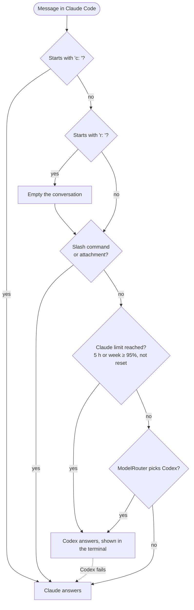

# ModelRouter

A CLI that picks the most suitable AI model for each question among the ones installed on your machine, then runs it.

```bash
ask "refactor this module"         # picks an agent, shows its choice, runs the answer
ask "Pâtes ou riz ?"               # short closed question: answered by Jev, no agent launched
ask --why "question"               # shows the choice and the command, runs nothing
ask --use codex "question"         # forces an agent
```

The router first classifies the question (task category and complexity from 0 to 4) with Jev, a classification service. It then picks the cheapest model able to handle it among the installed ones: Claude, Codex, Gemini, Ollama, or Jev itself for short closed questions.

## Routing logic


## Installation

Requirements: Python 3.9 and the CLIs of the agents you want to use (`claude`, `codex`, `gemini`, `ollama`).

```bash
git clone https://github.com/michael-martinez/ModelRouter.git
cd ModelRouter
ln -s "$PWD/bin/ask" ~/.local/bin/ask    # or any directory on your PATH
export JEV_API_KEY=...                   # optional: enables classification and closed questions
ask scan                                 # detects installed agents and models
```

`ask scan` writes the inventory to `~/.config/model-router/inventory.json`. Run it again after installing an agent or changing the catalog.

## How it works

- **Choice**: among the capable models (level high enough for the category and complexity), the cheapest one wins. If none is capable, the strongest installed model is used.
- **Conversation**: one thread per directory, valid for 30 minutes. An agent without a native session receives the previous questions and the last answer.
- **Codex**: runs read-only. `--write` lets it modify files in the directory.
- **Fallback**: if an agent fails without producing anything, the next model takes over.

## Comparison with other tools

The tools below solve adjacent problems. The descriptions come from third-party articles and vendor documentation, not from benchmarks run for this project.

| Tool | What it is | How it picks a model | Where it runs | Good fit when |
|---|---|---|---|---|
| [OpenCode](https://github.com/anomalyco/opencode) | Open-source coding agent with many providers | You choose the model per task | Local terminal | You want a full, maintained agent |
| [claude-code-router](https://github.com/musistudio/claude-code-router) | Local gateway for Claude Code | Routing rules you configure | Your machine | You want per-task rules inside Claude Code |
| [LiteLLM](https://github.com/BerriAI/litellm) | Self-hosted proxy for many APIs | Auto router for choosing a model per request | Your infrastructure | You run services that call LLM APIs |
| [OpenRouter](https://openrouter.ai) | Hosted gateway, one API key | Auto Router that picks a model for each prompt | Hosted, with a credit fee | You want the least setup |
| **ModelRouter** | Local CLI over the agent CLIs you already have | Jev classifies the question, then the cheapest capable installed model wins | Your machine | You already pay for several agents and want them to share the load |

**What is specific to ModelRouter**
- It wraps CLIs you already run (`claude`, `codex`, `gemini`, `ollama`). It does not call provider APIs with your keys.
- It keeps a conversation across agents: a Codex follow-up sees the previous questions and the last answer.
- It can switch from Claude to Codex when a Claude usage window reaches 95% (see *Use it from Claude Code*).

**What the others do better**
- OpenCode and claude-code-router are more mature and cover more providers.
- LiteLLM and OpenRouter need no local CLI, and LiteLLM has a cost and quality benchmark.
- ModelRouter has no interface of its own and depends on Jev, a paid external service, for classification.

## Catalog

`data/catalog.json` describes the agents, their commands and the level of each model. It is data: you can adjust costs and levels. For Codex, models that are not available on the connected account are dropped during the scan.

## Use it from Claude Code

The routing can also sit in front of Claude Code through a `UserPromptSubmit` hook. The hook is **not included** in this repository: it lives in your own Claude Code configuration and depends on your paths.

**Prefixes**

| Prefix | Effect |
|---|---|
| `c: ` | Always sent to Claude, even during a Codex conversation. Claude receives the prefix as typed. |
| `r: ` | Empties the conversation of the current directory, then handles the rest of the message normally |

Slash commands (`/…`) and messages with attachments (`[Image #…]`, `[Pasted…]`) always go to Claude.

**Conversation stickiness.** After a Codex answer, the following messages stay on Codex for 30 minutes, unless they use a prefix or fall under an exemption. Use `c: ` to go back to Claude for one message.

**Usage limit.** A status line reports Claude's 5-hour and weekly usage (subscription plans only, after the first response of a session). When one window reaches 95% before its reset time, messages that are not exempt go to Codex.

**Failures.** If Codex fails, Claude answers the message instead.



**Codex can write.** In this flow Codex runs with `--write`, so it can modify files in the directory. Claude does not know about those changes until you describe them to it.

## Tests

```bash
python3 -m venv .venv && .venv/bin/pip install pytest
.venv/bin/python -m pytest
```

Tests use fake objects only at the boundaries (Jev's HTTP calls, PATH lookup, agent launch).

## Known limits

- Routing depends on Jev's classification: without a key, the default profile is used.
- Agents are called through their CLI. Their options (sandbox, available models) may change between versions.
- Closed questions are detected by their form: a short question such as "X or Y?" is sent to Jev.

## License

MIT. See [LICENSE](LICENSE).
