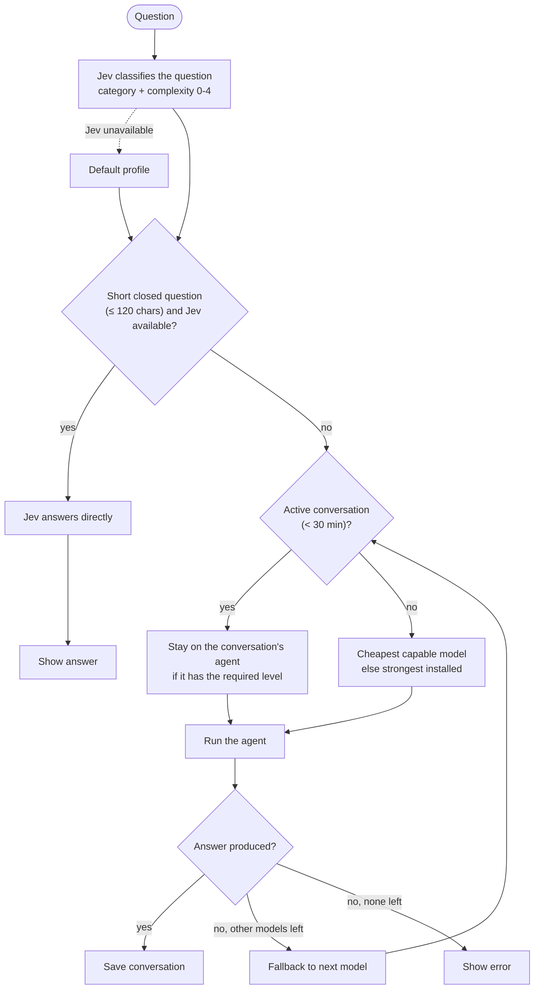

# ModelRouter

A CLI that picks the most suitable AI model for each question among the ones installed on your machine, then runs it.

```bash
ask "refactor this module"         # picks an agent, shows its choice, runs the answer
ask "Pâtes ou riz ?"               # short closed question: answered by Jev, no agent launched
ask --why "question"               # shows the choice and the command, runs nothing
ask --use codex "question"         # forces an agent
```

The router first classifies the question (task category and complexity from 0 to 4) with Jev, a classification service. It then picks the cheapest model able to handle it among the installed ones: Claude, Codex, Gemini, Ollama, or Jev itself for short closed questions.

## Routing logic



## Installation

Requirements: Python 3.9 and the CLIs of the agents you want to use (`claude`, `codex`, `gemini`, `ollama`).

```bash
git clone https://github.com/michael-martinez/ModelRouter.git
cd ModelRouter
ln -s "$PWD/bin/ask" ~/.local/bin/ask    # or any directory on your PATH
export JEV_API_KEY=...                   # optional: enables classification and closed questions
ask scan                                 # detects installed agents and models
```

`ask scan` writes the inventory to `~/.config/model-router/inventory.json`. Run it again after installing an agent or changing the catalog.

## How it works

- **Choice**: among the capable models (level high enough for the category and complexity), the cheapest one wins. If none is capable, the strongest installed model is used.
- **Conversation**: one thread per directory, valid for 30 minutes. An agent without a native session receives the previous questions and the last answer.
- **Codex**: runs read-only. `--write` lets it modify files in the directory.
- **Fallback**: if an agent fails without producing anything, the next model takes over.

## Catalog

`data/catalog.json` describes the agents, their commands and the level of each model. It is data: you can adjust costs and levels. For Codex, models that are not available on the connected account are dropped during the scan.

## Tests

```bash
python3 -m venv .venv && .venv/bin/pip install pytest
.venv/bin/python -m pytest
```

Tests use fake objects only at the boundaries (Jev's HTTP calls, PATH lookup, agent launch).

## Known limits

- Routing depends on Jev's classification: without a key, the default profile is used.
- Agents are called through their CLI. Their options (sandbox, available models) may change between versions.
- Closed questions are detected by their form: a short question such as "X or Y?" is sent to Jev.

## License

MIT. See [LICENSE](LICENSE).
